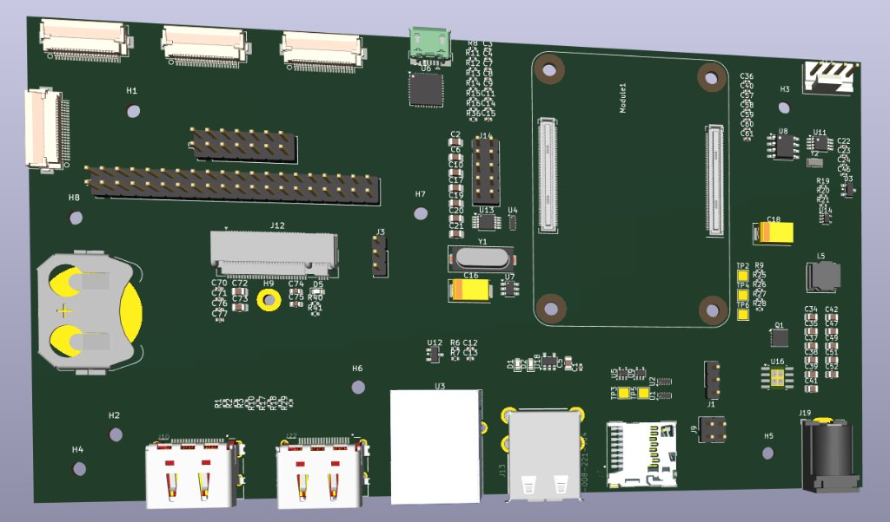

# Raspberry Pi CM4 High-Speed Carrier Board

## 📌 Project Summary
A custom 4-layer carrier board designed for the **Raspberry Pi Compute Module 4 (CM4)**. Engineered for high-speed connectivity and embedded processing, this board integrates a high-performance M.2 NVMe SSD over PCIe Gen 2, Gigabit Ethernet, HDMI display output, dual USB 2.0 ports, a real-time clock (RTC), and a dedicated 40-pin GPIO expansion interface.

---

## 📐 Key Specifications
* **Host Processor**: Raspberry Pi Compute Module 4 (Broadcom BCM2711 quad-core Cortex-A72) via dual 100-pin Hirose DF40 high-density connectors.
* **Storage Interface**: M.2 Key-M socket supporting PCIe Gen 2 x1 ($5\text{ Gbps}$) NVMe Solid-State Drives.
* **Networking**: 1000BASE-T Gigabit Ethernet via integrated magnetic RJ45 jack.
* **Display Output**: Full-size HDMI 2.0 connector with integrated ESD protection.
* **Peripherals**: 2x USB 2.0 Type-A ports via onboard USB 2.0 hub controller; Micro-SD slot for CM4 Lite; RTC battery backup.
* **Board Dimensions**: $85\text{ mm} \times 56\text{ mm}$ (credit-card form factor).
* **Layer Count**: 4 Layers (Signal – Ground Reference – Power Split – Signal).

---

## ⚡ High-Speed Controlled Impedance & Stackup
Designed against the **JLCPCB JLC04161H-7628** stackup ($1.6\text{ mm}$ total thickness, FR-4 $\epsilon_r \approx 4.6$):

| Layer | Type | Copper Thickness | Dielectric / Prepreg | Nominal Dielectric Thickness |
| :--- | :--- | :---: | :--- | :---: |
| **Layer 1 (Top)** | High-Speed Signals & Local Power | $35\,\mu\text{m}$ ($1\text{ oz}$) | Prepreg 7628 | $0.21\text{ mm}$ ($8.27\text{ mils}$) |
| **Layer 2 (In1)** | **Unbroken Solid Ground Plane (GND)** | $17.5\,\mu\text{m}$ ($0.5\text{ oz}$) | FR-4 Core | $1.065\text{ mm}$ |
| **Layer 3 (In2)** | **Power Distribution Planes (+3.3V, +5V, +12V)** | $17.5\,\mu\text{m}$ ($0.5\text{ oz}$) | Prepreg 7628 | $0.21\text{ mm}$ ($8.27\text{ mils}$) |
| **Layer 4 (Bottom)**| High-Speed Signals & Low-Speed I/O | $35\,\mu\text{m}$ ($1\text{ oz}$) | — | — |

### Differential Pair Constraints
* **PCIe Gen 2 Differential Pairs** (`PCIE_TX_P/N`, `PCIE_RX_P/N`, `PCIE_CLK_P/N`):
  * Target Differential Impedance: $100\,\Omega \pm 10\%$
  * Trace Width ($W$): $0.20\text{ mm}$ | Gap ($S$): $0.18\text{ mm}$ | Intra-pair Length Mismatch: $<0.15\text{ mm}$ ($6\text{ mils}$)
* **USB 2.0 High-Speed Pairs** (`USB_D_P/N`):
  * Target Differential Impedance: $90\,\Omega \pm 10\%$
  * Trace Width ($W$): $0.30\text{ mm}$ | Gap ($S$): $0.18\text{ mm}$ | Intra-pair Length Mismatch: $<0.50\text{ mm}$
* **Power Distribution Network (PDN)**:
  * Minimum trace width: $0.80\text{ mm}$ ($>3.2\text{ A}$ continuous capacity).
  * Via drills: $0.30\text{ mm}$ hole / $0.60\text{ mm}$ pad with stitching pairs at plane transitions.

---

## 📁 Project Directory Contents
* [`hardware/`](hardware/): Complete KiCad project database (`CM4_Mini_PC.kicad_pro`), hierarchical schematics, and PCB layout (`CM4_Mini_PC.kicad_pcb`).
* [`images/CM4_3D_Render.jpg`](images/CM4_3D_Render.jpg): High-resolution photo-realistic 3D rendering of the populated carrier board.
* [`images/CM4_PCB_Layout.pdf`](images/CM4_PCB_Layout.pdf): Vector 2D layout artwork showing copper layers, silkscreen, and courtyard boundaries.
* [`images/CM4_Schematics.pdf`](images/CM4_Schematics.pdf): 7-sheet hierarchical schematic packet (Power, CM4 High-Speed, M.2 NVMe, USB, RTC, GPIO).
