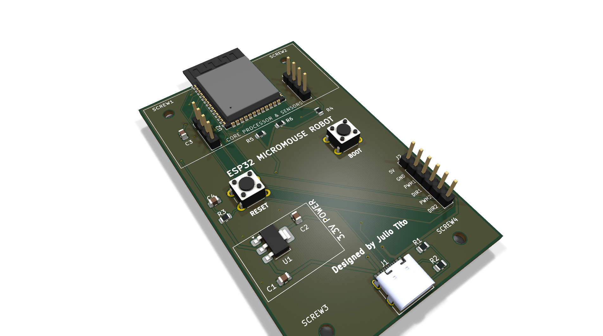

# ESP32-S3 Micromouse Robotics Controller

## 📌 Project Summary
A custom 2-layer autonomous robotics motherboard engineered for an IEEE Micromouse competition robot. Powered by the **ESP32-S3** dual-core microcontroller with onboard Wi-Fi and Bluetooth LE, this board integrates dual high-efficiency H-bridge motor drivers, optical quadrature encoder interfaces, multi-channel infrared distance sensor headers, and onboard DC-DC buck regulation.

---

## 📐 Key Specifications
* **Microcontroller**: Espressif ESP32-S3-WROOM-1 (240 MHz dual-core Xtensa LX7, 512 KB SRAM, 8 MB Flash).
* **Motor Drive Architecture**: Dual integrated H-bridge drivers capable of bidirectional PWM speed and direction control.
* **Sensor Interfaces**:
  * 4x IR distance sensor analog inputs with filtered reference rails.
  * Dual optical quadrature encoder inputs for closed-loop odometry and PID trajectory tracking.
* **Power Management**:
  * 2S LiPo battery input ($7.4\text{ V} - 8.4\text{ V}$).
  * High-efficiency DC-DC step-down buck converter delivering stable $+3.3\text{ V}$ and $+5.0\text{ V}$ logic rails.
* **Connectivity & Debug**: USB Type-C interface for direct firmware flashing and UART serial diagnostics.
* **Layer Count**: 2 Layers (Top Component/Signal + Bottom Ground Pour).

---

## 📁 Project Directory Contents
* [`hardware/`](hardware/): KiCad project files (`esp32_micromouse_controller.kicad_pro`), schematics, PCB layout, and production Gerbers.
* [`images/ESP32_Micromouse_3D_Render.png`](images/ESP32_Micromouse_3D_Render.png): 3D orthographic render of the assembled micromouse controller.
* [`images/ESP32_Micromouse_PCB_Layout.pdf`](images/ESP32_Micromouse_PCB_Layout.pdf): 2D PCB layout artwork.
* [`images/ESP32_Micromouse_Schematic.pdf`](images/ESP32_Micromouse_Schematic.pdf): Complete schematic schematic diagram.
