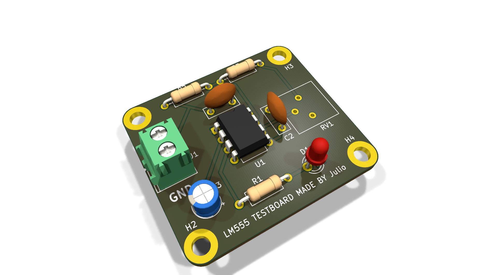
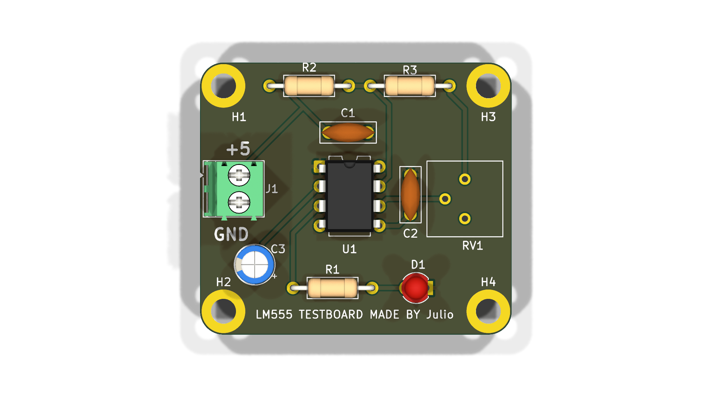

# LM555 Precision Timer Testboard

  
  

  <em>Figure 1: (Left) Raytraced 3D model with balanced camera perspective and floor reflections. (Right) KiCad PCB Editor layout showing traces, pads, and component silkscreen.</em>

  
   
  <em>Figure 2: Orthogonal Top 3D view showing DIP-8 socket, timing passives, output buffer LED, and oscilloscope test points.</em>

## 📌 Project Summary
A precision analog timing and waveform generation testboard built around the industry-standard **LM555 / NE555** bipolar timer IC. Designed as an educational and hardware validation platform, it allows hands-on characterization of astable multivibrators, frequency tuning, pulse-width modulation (PWM), and transient response.

---

## 📐 Key Specifications & Circuit Physics
* **Timer IC**: LM555 / NE555 Timer in standard 8-pin DIP package with socket header.
* **Oscillator Mode**: Astable Multivibrator configuration generating continuous square-wave output.
* **Frequency Calculation**:
  $$f = \frac{1.44}{(R_1 + 2R_2) C}$$
  $$T_H = 0.693 \cdot (R_1 + R_2) \cdot C, \quad T_L = 0.693 \cdot R_2 \cdot C$$
  $$\text{Duty Cycle} = \frac{R_1 + R_2}{R_1 + 2R_2} \times 100\%$$
* **User Feedback & Indicators**:
  * Transistor-buffered output LED for visual pulse frequency verification.
  * Dedicated high-impedance oscilloscope test points (GND, TRIG, THRES, OUT, VCC).
* **Decoupling Network**: Low-ESR ceramic decoupling capacitors on Pin 5 ($0.01\,\mu\text{F}$) for noise immunity on the internal $2/3\,V_{CC}$ comparator threshold.
* **Layer Count**: 2 Layers (Top Signal/Power, Bottom Ground Plane).

---

## 📁 Project Directory Contents
* [`hardware/`](hardware/): KiCad project files (`LM555_Testboard.kicad_pro`), schematics, PCB layout, and bill of materials (`LM555_Testboard.csv`).
* [`images/lm555_3d_render.png`](images/lm555_3d_render.png): High-resolution raytraced 3D render.
* [`images/lm555_pcb_layout.png`](images/lm555_pcb_layout.png): KiCad PCB Editor layout artwork.
* [`images/lm555_3d_top.png`](images/lm555_3d_top.png): Top orthogonal 3D view.
* [`images/LM555_Timer_Schematic.pdf`](images/LM555_Timer_Schematic.pdf): Complete schematic diagram.
