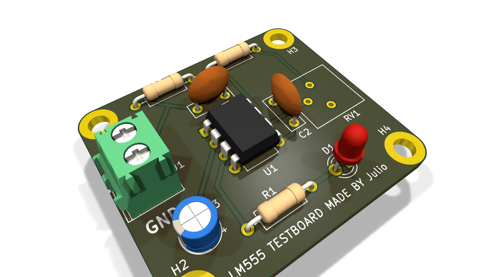

# KiCad Hardware & PCB Design Portfolio
**Julio Tito** | Electrical & Computer Engineering (ECE)  
[GitHub Profile](https://github.com/JulioxTito) • [Master Portfolio & Interview Packet (PDF)](docs/Julio_Tito_Complete_Hardware_Portfolio_Master.pdf) • [Engineering Defense Guide](docs/Interview_Defense_Guide.pdf)

---

## 📌 Overview
This repository serves as a centralized hardware engineering portfolio showcasing custom Printed Circuit Board (PCB) designs created in **KiCad**. The projects span fundamental analog signal generation, embedded microcontroller robotics systems, and complex 4-layer high-speed digital carrier boards featuring controlled impedance differential signaling.

Each project directory contains production-ready schematics, PCB layout databases, Gerber archives, 3D photo-realistic renders, and technical design documentation.

---

## 🚀 Featured Hardware Projects

| Project | Category | Layers | Primary Interfaces / ICs | Preview |
| :--- | :--- | :---: | :--- | :---: |
| **[01. CM4 High-Speed Carrier Board](01_CM4_HighSpeed_Carrier/)** | High-Speed Digital / Embedded | 4 | Raspberry Pi CM4, PCIe Gen 2 ($5\text{ Gbps}$), M.2 Key-M NVMe SSD, Gigabit Ethernet, HDMI, Dual USB 2.0 |  |
| **[02. ESP32-S3 Micromouse Controller](02_ESP32_Micromouse_Controller/)** | Robotics / Power & Control | 2 | ESP32-S3 Dual-Core MCU, Dual H-Bridge Motor Drivers, Quadrature Encoders, IR Sensors, Buck Converter |  |
| **[03. LM555 Precision Timer Testboard](03_LM555_Timer_Testboard/)** | Analog & Mixed-Signal | 2 | LM555 Precision Timer, Astable/Monostable Oscillators, BJT LED Buffers, Oscilloscope Test Points |  |

---

## 📑 Portfolio Documentation & Review Deliverables

A comprehensive, all-in-one 25-page technical print packet is compiled and available in the [`docs/`](docs/) directory:
* 📄 **[Julio_Tito_Complete_Hardware_Portfolio_Master.pdf](docs/Julio_Tito_Complete_Hardware_Portfolio_Master.pdf)**: Complete master portfolio containing high-resolution schematics, 2D PCB artwork, 3D orthographic renders, and stackup calculations for all boards.
* 📄 **[Interview_Defense_Guide.pdf](docs/Interview_Defense_Guide.pdf)**: 1-hour interview walkthrough guide covering architecture trade-offs, IPC-2141 impedance math, PDN decoupling strategies, and DRC verification.

---

## 🛠️ Repository Architecture & Future Expansion

This repository is structured modularly to allow continuous addition of future hardware designs (e.g., USB-C bridge controllers, motor drivers, sensor breakout boards):

```text
KiCad-Projects/
├── docs/                                    # Master portfolio PDFs and engineering notes
├── 01_CM4_HighSpeed_Carrier/                # 4-layer high-speed PCIe Gen 2 carrier
│   ├── hardware/                            # KiCad .kicad_pro, .kicad_sch, .kicad_pcb
│   ├── images/                              # 3D renders, PCB artwork, schematic PDFs
│   └── README.md                            # High-speed routing rules, stackup, power budget
├── 02_ESP32_Micromouse_Controller/          # Dual H-bridge robotics controller
│   ├── hardware/                            # KiCad files, BOM, production Gerbers
│   ├── images/                              # 3D renders, PCB artwork, schematic PDFs
│   └── README.md                            # Motor driver isolation, encoder pinouts
├── 03_LM555_Timer_Testboard/                # Analog precision timing circuit
│   ├── hardware/                            # KiCad files, manufacturing outputs
│   ├── images/                              # 3D renders, PCB artwork, schematic PDFs
│   └── README.md                            # Multivibrator formulas, test procedures
└── .gitignore                               # Standard KiCad backup and lock file exclusions
```

### Adding New Projects
To add a new project to this portfolio:
1. Create a numbered subdirectory (e.g. `04_USB_C_NVMe_Bridge/`).
2. Add `hardware/` with KiCad files and `images/` with exports.
3. Include a local `README.md` summarizing design parameters.
4. Append a row to the master portfolio table above.

---

## 💻 Tooling & Standards
* **EDA Suite**: KiCad EDA (v8 / v9 / v10 compatible)
* **High-Speed Standards**: IPC-2141 / IPC-2221 Controlled Impedance Microstrip Models
* **Differential Signaling**: PCIe Gen 2 ($100\,\Omega \pm 10\%$), USB 2.0 ($90\,\Omega \pm 10\%$)
* **Fabrication Reference**: JLCPCB standard stackups (JLC04161H-7628 4-Layer / Standard 2-Layer FR-4)

---
*Created and maintained by Julio Tito (2026).*
