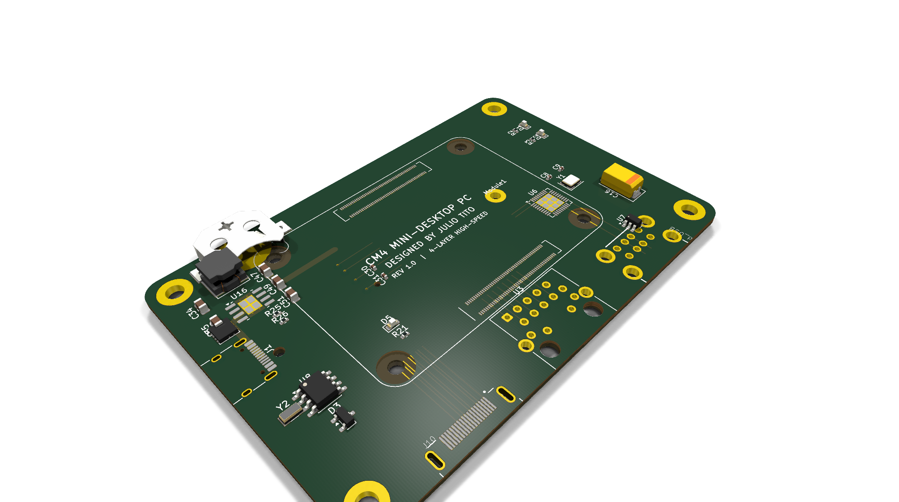
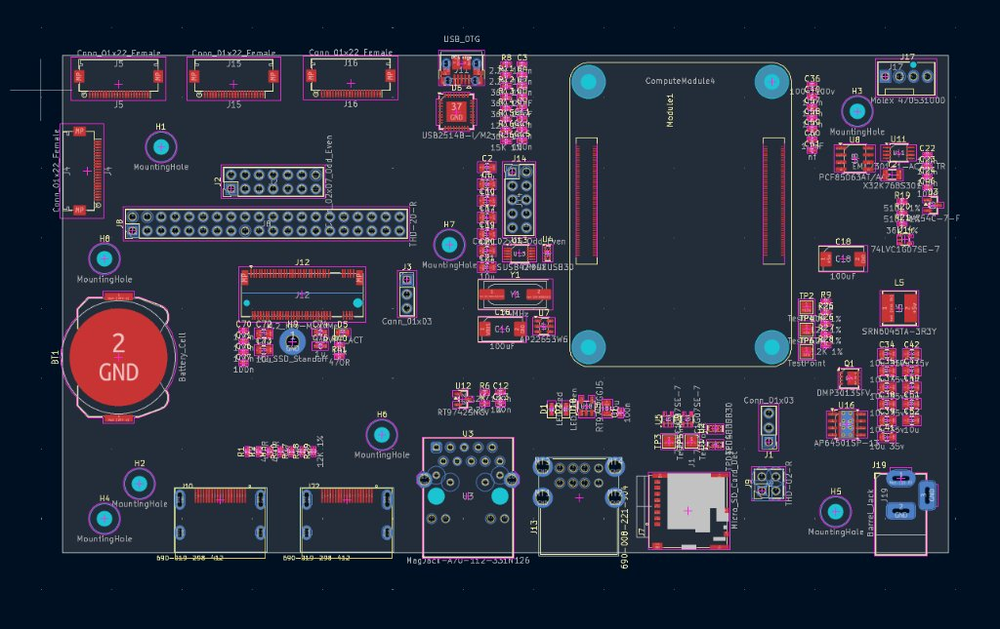
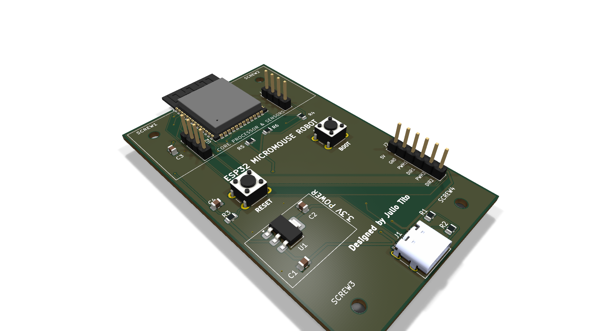
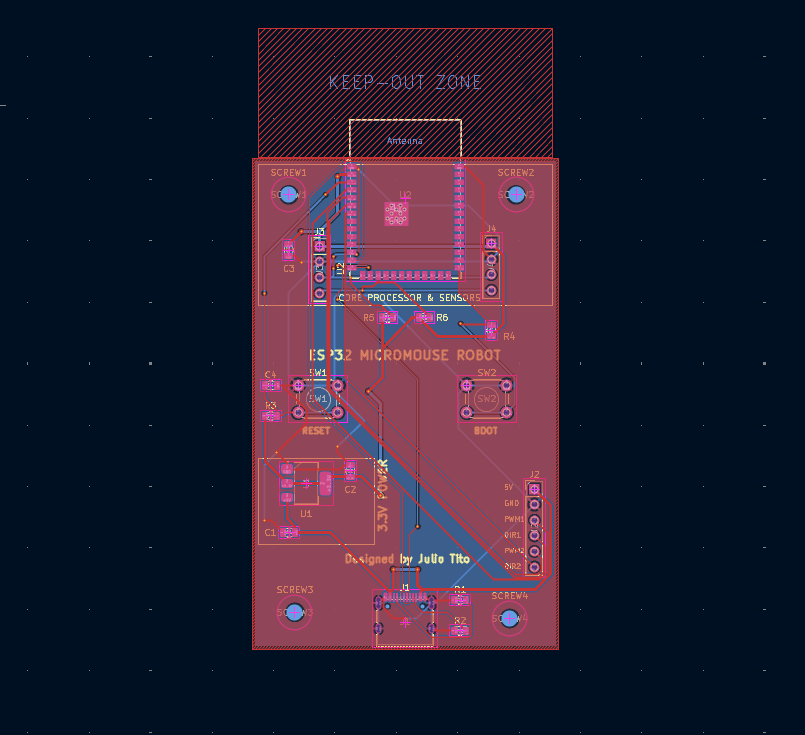
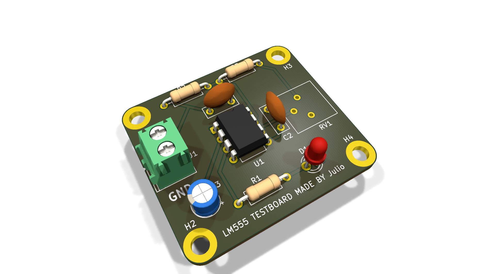
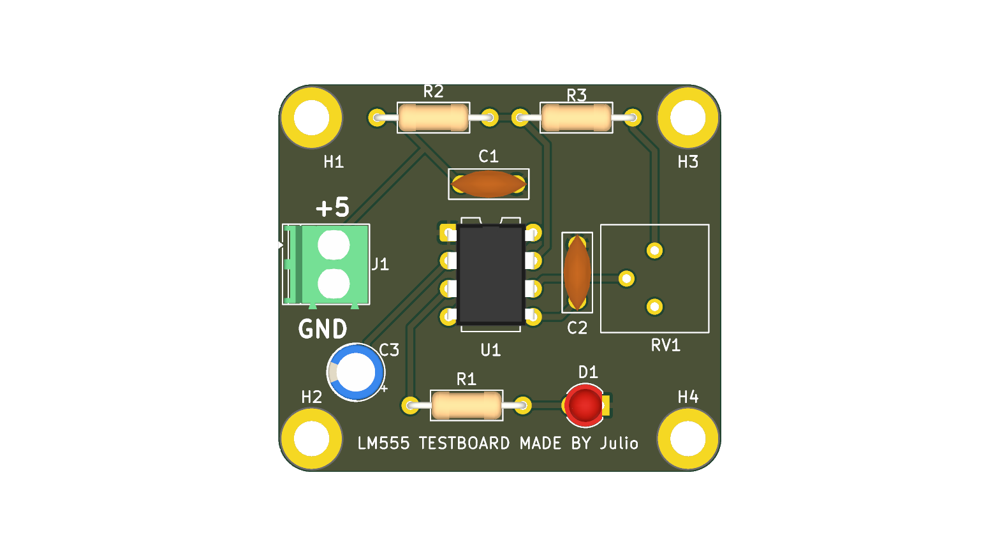

# KiCad Hardware & PCB Design Portfolio
**Julio Tito** | Electrical & Computer Engineering (ECE)  
[GitHub Profile](https://github.com/JulioxTito) • [Master Portfolio & Interview Packet (PDF)](docs/Julio_Tito_Complete_Hardware_Portfolio_Master.pdf) • [Engineering Defense Guide](docs/Interview_Defense_Guide.pdf)

---

## 📌 Overview
This repository serves as a centralized hardware engineering portfolio demonstrating custom Printed Circuit Board (PCB) designs created in **KiCad**. The projects span fundamental analog signal generation, embedded microcontroller robotics systems, and complex 4-layer high-speed digital carrier boards featuring controlled-impedance differential signaling.

Each project showcases both the **3D Raytraced Hardware Model** and the **2D KiCad PCB Designer Layout**, accompanied by production Gerbers, schematics, and design calculations.

---

## 🚀 Featured Hardware Projects

### 1. [Raspberry Pi CM4 High-Speed Carrier Board](01_CM4_HighSpeed_Carrier/)
> **4-Layer High-Speed Digital Carrier** | Broadcom BCM2711, PCIe Gen 2 ($5\text{ Gbps}$) NVMe SSD, Gigabit Ethernet, 4K HDMI, Dual USB 2.0

<p align="center">
  
  
</p>
<p align="center">
  <em>(Left) 3D Raytraced assembly with M.2 NVMe SSD, RJ45 MagJack, and HDMI. (Right) KiCad PCB Editor routing and floorplan.</em>
</p>

* **Stackup**: JLCPCB JLC04161H-7628 ($1.6\text{ mm}$, FR-4 $\epsilon_r \approx 4.6$) with unbroken Layer 2 Ground plane.
* **Controlled Impedance**: PCIe Gen 2 ($100\,\Omega \pm 10\%$, $W=0.20\text{ mm}$, $S=0.18\text{ mm}$) and USB 2.0 ($90\,\Omega \pm 10\%$, $W=0.30\text{ mm}$, $S=0.18\text{ mm}$).
* **Deliverables**: [Project README](01_CM4_HighSpeed_Carrier/) • [Schematics PDF](01_CM4_HighSpeed_Carrier/images/CM4_Schematics.pdf) • [PCB Layout Artwork](01_CM4_HighSpeed_Carrier/images/CM4_PCB_Layout.pdf)

---

### 2. [ESP32-S3 Micromouse Robotics Controller](02_ESP32_Micromouse_Controller/)
> **2-Layer Autonomous Robotics Motherboard** | ESP32-S3 Dual-Core MCU, Dual H-Bridge Motor Drivers, Optical Encoders, IR Sensors

<p align="center">
  
  
</p>
<p align="center">
  <em>(Left) Full-board raytraced 3D isometric perspective. (Right) KiCad PCB Editor layout with ground plane flood.</em>
</p>

* **Core Subsystem**: ESP32-S3-WROOM-1 (240 MHz dual-core Xtensa LX7, Wi-Fi / BLE) with RF antenna keep-out.
* **Peripherals**: Dual H-bridge motor drivers, optical quadrature encoder inputs for closed-loop PID control, dual ToF/IR sensor headers, onboard DC-DC buck power delivery.
* **Deliverables**: [Project README](02_ESP32_Micromouse_Controller/) • [Schematics PDF](02_ESP32_Micromouse_Controller/images/ESP32_Micromouse_Schematic.pdf) • [PCB Layout Artwork](02_ESP32_Micromouse_Controller/images/ESP32_Micromouse_PCB_Layout.pdf)

---

### 3. [LM555 Precision Timer Testboard](03_LM555_Timer_Testboard/)
> **2-Layer Analog & Mixed-Signal Platform** | LM555 Precision Timer, Astable Multivibrator, BJT LED Buffers, Test Points

<p align="center">
  
  
</p>
<p align="center">
  <em>(Left) Raytraced 3D model with floor reflections. (Right) KiCad PCB Editor copper routing & silkscreen.</em>
</p>

* **Circuit Physics**: Astable oscillator with frequency $f = \frac{1.44}{(R_1 + 2R_2)C}$ and low-ESR bypass decoupling.
* **Validation Interface**: High-impedance oscilloscope test points (TRIG, THRES, OUT, VCC, GND) for transient & ripple analysis.
* **Deliverables**: [Project README](03_LM555_Timer_Testboard/) • [Schematics PDF](03_LM555_Timer_Testboard/images/LM555_Timer_Schematic.pdf) • [PCB Layout Artwork](03_LM555_Timer_Testboard/images/LM555_Timer_PCB_Layout.pdf)

---

## 📑 Master Portfolio & Review Deliverables

A compiled 25-page hardware portfolio print packet is available in the [`docs/`](docs/) directory:
* 📄 **[Julio_Tito_Complete_Hardware_Portfolio_Master.pdf](docs/Julio_Tito_Complete_Hardware_Portfolio_Master.pdf)**: Complete 25-page unified master packet containing all schematics, 2D PCB artwork, 3D orthographic renders, and stackup calculations.
* 📄 **[Interview_Defense_Guide.pdf](docs/Interview_Defense_Guide.pdf)**: 1-hour interview walkthrough guide covering architecture trade-offs, IPC-2141 impedance math, PDN decoupling, and DRC verification.

---

## 🛠️ Repository Architecture & Future Expansion

This repository is built modularly so small utility boards, breakout shields, and future complex designs can be dropped in easily:

```text
KiCad-Projects/
├── docs/                                    # Master portfolio PDFs and engineering notes
├── 01_CM4_HighSpeed_Carrier/                # 4-layer high-speed PCIe Gen 2 carrier
│   ├── hardware/                            # KiCad .kicad_pro, .kicad_sch, .kicad_pcb
│   ├── images/                              # 3D renders, PCB layout views, schematics
│   └── README.md                            # High-speed routing rules, stackup, power budget
├── 02_ESP32_Micromouse_Controller/          # Dual H-bridge robotics controller
│   ├── hardware/                            # KiCad files, BOM, production Gerbers
│   ├── images/                              # 3D renders, PCB layout views, schematics
│   └── README.md                            # Motor driver isolation, encoder pinouts
├── 03_LM555_Timer_Testboard/                # Analog precision timing circuit
│   ├── hardware/                            # KiCad files, manufacturing outputs
│   ├── images/                              # 3D renders, PCB layout views, schematics
│   └── README.md                            # Multivibrator formulas, test procedures
└── .gitignore                               # Standard KiCad backup and lock file exclusions
```

---
*Created and maintained by Julio Tito (2026).*
